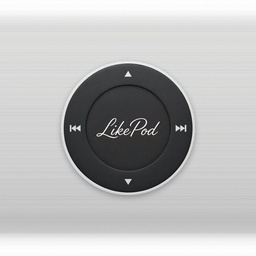

# LikePod

复古滚轮播放器，使用 Flutter 构建。彩色 LCD，下面是圆形滚轮。

LikePod is a Classic-style wheel player built with Flutter: a color LCD over a round click wheel.




设备实机截图还没有放进仓库。上面是应用标识。

Device screenshots are not in the tree yet. The image above is the app mark.

## 功能 / Features

- 主菜单、音乐库、Cover Flow、正在播放、设置
- 滚轮滑动选择，中心键确认，MENU 返回；可开关滚轮音和触感
- 曲库来自你勾选的文件夹（MediaStore）。标题、艺人、专辑、时长和封面来自系统媒体库
- 正在播放：封面、歌名、艺人、专辑、进度、音量、星级，以及底部点阵柱
- 机身配色：Space Gray、Classic White、Metallic Silver、Stealth Black
- 手机上外壳圆角跟随系统圆角，不裁剪点阵柱
- 设置、星级、上次曲目、队列和进度会记住。下次打开停在主菜单，进度处于暂停，按播放续听
- 关于页居中，并列出开源许可

- Menus for music, Cover Flow, Now Playing, and settings
- Wheel scroll, center select, MENU back; optional wheel sounds and haptics
- Library from folders you choose. Title, artist, album, duration, and art come from the system media store
- Now Playing shows the cover, title, artist, album, progress, volume, rating, and the dot-column waveform
- Shell colors: Space Gray, Classic White, Metallic Silver, Stealth Black
- On a phone the outer shell follows the system corner radii and does not clip the waveform
- Settings, ratings, and the last track, queue, and position are kept. The next launch stays on the main menu, paused
- About is centered and lists open-source notices

## 安装 / Install

只含 `arm64-v8a`。安装前核对 MD5 和证书。若以后的包装了另一把签名，不能直接覆盖这次安装，需要先卸载。

The APK is arm64-v8a only. Check the MD5 and certificate before installing. A later build signed with a different key cannot replace this install; uninstall first.

标签 `v0.1.0` 指向包含这些文档的提交。安装包打自 `8b9084c92bb6785f91c19d60b5ac37a3b9313a33`，MD5 不变。说明见 `BASELINE.md` 和 `CHANGELOG.md`。

Tag `v0.1.0` points at the commit that contains these docs. The package was built from `8b9084c92bb6785f91c19d60b5ac37a3b9313a33`; the MD5 is unchanged. See `BASELINE.md` and `CHANGELOG.md`.

## 运行 / Run

需要已安装的 Flutter SDK。

The Flutter SDK must be installed.

```bash
flutter pub get
flutter run
```

发布包只打 arm64：

The release package is arm64 only:

```bash
flutter build apk --release --target-platform android-arm64
```

测试：

Tests:

```bash
flutter analyze
flutter test
```

更多构建说明见 `CONTRIBUTING.md`。

More build notes are in `CONTRIBUTING.md`.

## Android

播放走系统混音（just_audio + audio_service）。USB 声卡只有在 Android 自己把音乐流路由过去时才会出声。应用不独占 USB 接口。

Playback uses the system mixer (just_audio + audio_service). A USB DAC is heard only when Android routes the music stream to it. The app does not claim a USB interface.

点阵柱读取正在播放的会话。捕获策略在音轨创建之前设为允许捕获，否则可视化读到的是静音。

The dot columns read the playing session. The capture policy is set to allow capture before the track is created; otherwise the visualizer stays silent.

`audio_service` 在播放时拉起 `mediaPlayback` 前台服务。通知栏和锁屏有上一首、播放/暂停、下一首。暂停时服务仍保持前台，以便在 Android 12+ 上继续控制。

`audio_service` starts a `mediaPlayback` foreground service when playback begins. The notification and lock screen expose previous, play/pause, and next. The service stays in the foreground while paused so Android 12+ can keep controlling it.

其他应用拿走音频焦点时 LikePod 暂停。若暂停只是因为焦点被抢走，对方结束后会续播。自己按暂停，或下次冷启动，不会自动播。

LikePod pauses when another app takes audio focus. If that pause was only a focus loss, playback resumes when the other app stops. A manual pause, or the next cold start, does not auto-play.

仍未覆盖 / still open:

- 通知栏封面只用 MediaStore 专辑图。内嵌封面不会进通知；屏幕里的封面不受影响。
- 进程被系统杀掉后，不会从通知栏冷启动续播。再次打开会恢复上次进度（暂停）。
- 从最近任务划掉时，系统可能拆掉媒体服务。
- 没有 Android Auto，也没有自定义通知布局。
- 滚轮点击音不进入媒体会话。

- Notification art uses the MediaStore album URI only. Embedded art stays on the in-app cover.
- If the process is killed, the notification cannot cold-start playback. Opening the app restores the last position, paused.
- Swiping the app away may tear down the media service.
- No Android Auto, and no custom notification layout.
- Wheel clicks are not part of the media session.

已发布的包：minSdk 24，targetSdk 36。

The shipped package: minSdk 24, targetSdk 36.

Windows 工程目录不在初始树里。需要时：

The Windows platform folder is not in the initial tree. When needed:

```bash
flutter create . --platforms=windows
```

## 许可 / License

本项目采用 MIT 许可，见 `LICENSE`。第三方组件、ExoPlayer / AndroidX Media3、Material Icons 与 Noto Sans SC 见 `THIRD_PARTY_NOTICES`。Noto Sans SC 子集的 OFL-1.1 全文在 `licenses/NotoSansSC-OFL.txt`。应用内「关于 → 开源许可」可以阅读同一份名单。

This project is MIT licensed. See `LICENSE`. Third-party components, ExoPlayer / AndroidX Media3, Material Icons, and Noto Sans SC are listed in `THIRD_PARTY_NOTICES`. The OFL-1.1 text for the Noto Sans SC subset is `licenses/NotoSansSC-OFL.txt`. The same list is in the app under About → 开源许可.
